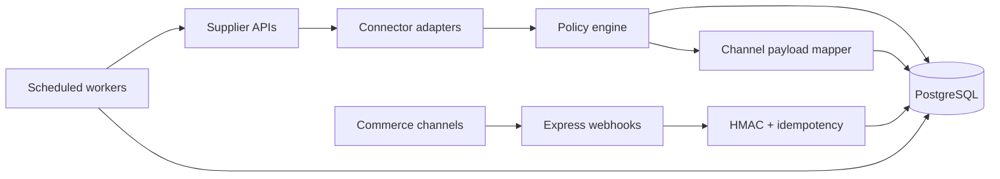
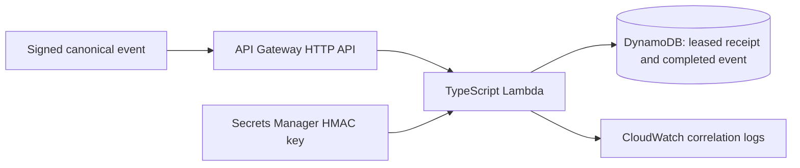

# Commerce Integration Core

[](https://github.com/yaseenmahdi/commerce-integration-core/actions/workflows/ci.yml)

Backend integration platform for normalizing supplier catalog data, applying channel-specific commerce rules, persisting inventory and order state, verifying webhooks, and monitoring fulfillment SLAs across multiple commerce channels.

The project focuses on the integration layer between external supplier systems and sales channels: API adapters, canonical data modeling, policy enforcement, idempotent event handling, scheduled workers, and operational state.

## Highlights

- **Supplier normalization** — shared product and variant models behind CJ REST and Zendrop MCP adapters.
- **Policy engine** — evaluates warehouse origin, stock, transit windows, GTIN/packaging requirements, and channel eligibility.
- **PostgreSQL persistence** — canonical catalog, inventory snapshots, channel listings, orders, webhook events, sync jobs, and SLA watches.
- **Webhook security** — HMAC verification with timing-safe comparison for Shopify, TikTok Shop, Walmart, and CJ event routes.
- **Idempotent processing** — database uniqueness constraints prevent duplicate webhook/order processing.
- **Resilient API access** — bounded retry/backoff with jitter and `Retry-After` support.
- **Scheduled operations** — inventory and fulfillment-SLA workers registered with `node-cron`.
- **Automated verification** — unit tests cover policy rules, SLA behavior, listing mapping, connector behavior, and webhook signatures.

## Architecture



More detail: [Architecture](docs/ARCHITECTURE.md) · [Operations](docs/OPERATIONS.md) · [Design decisions](docs/DESIGN_DECISIONS.md)

## Tech stack

- TypeScript / Node.js
- Express
- PostgreSQL 16
- Docker Compose
- Zod configuration validation
- Pino structured logging
- `node-cron` scheduled workers
- Node test runner

## Quick start

Requirements: Node.js 22+ and Docker.

```bash
git clone https://github.com/yaseenmahdi/commerce-integration-core.git
cd commerce-integration-core
cp .env.example .env
docker compose up -d
npm install
npm run db:migrate
npm run dev
```

PowerShell equivalent for the environment file:

```powershell
Copy-Item .env.example .env
```

Verify the service:

```text
GET http://localhost:8080/health
```

External supplier connectors are disabled in `.env.example`, so local setup does not require API credentials just to start the database or run the test suite.

## Validation

```bash
npm run typecheck
npm test
npm run build
```

The tests are designed to run without live supplier or marketplace credentials.

## Project structure

```text
src/
  connectors/   supplier clients, normalized types, retry/backoff, listing mapping
  database/     PostgreSQL pool and persistence helpers
  enrichment/   optional catalog scoring and listing-copy helpers
  policy/       shipping/channel eligibility and fulfillment-SLA rules
  webhooks/     signature verification and inbound event routes
  workers/      inventory synchronization and SLA monitoring
scripts/        migrations and manual worker entry points
sql/            PostgreSQL schema
docs/           architecture, operations, and design notes
```

## Security and reliability

- Credentials are loaded from environment variables and excluded from version control.
- Webhooks are authenticated before processing.
- Inbound events and orders use database-backed idempotency.
- External HTTP calls use retry/backoff behavior.
- Synchronization and SLA state are persisted instead of relying on process memory.
- Supplier connectors and optional enrichment are disabled by default in the example environment.

## Current scope

This repository prepares and stores channel-specific listing payloads and processes inbound integration events. Live marketplace publishing and automated supplier purchasing are intentionally not enabled by default.

## Why this project

Commerce APIs often disagree on data shape, authentication, fulfillment rules, and lifecycle state. This project explores the backend engineering required to put a stable integration layer between those systems rather than coupling application logic directly to any single external API.

## AWS serverless webhook extension

The original Express/PostgreSQL application remains available. The additive serverless path accepts a custom signed `order.created` envelope through API Gateway HTTP API, verifies its exact raw bytes in a TypeScript Lambda, and durably records it in DynamoDB. It does not accept native marketplace payloads or place orders.



HMAC-SHA256 authenticates the signed body, including the event UUID. Conditional DynamoDB writes select one processing owner; completion atomically stores the notification. Identical completed events return a duplicate acknowledgement, unfinished events return retryable `503` responses, and reused IDs with different raw bytes return `409`. Completion rows expire through a seven-day asynchronous TTL, so permanent replay prevention is not promised.

Install and verify from the repository root:

```bash
npm ci
npm run typecheck
npm test
npm run build
npm run build:serverless
sam validate --lint
sam build
```

The [serverless guide](docs/SERVERLESS.md) contains the exact payload/signature contract, DynamoDB Local commands, secret configuration, architecture tradeoffs, CloudWatch queries, deployment/teardown commands, cost and security considerations, known limitations, and a learning walkthrough. [Validation evidence](docs/VALIDATION.md) distinguishes checks actually run from live AWS checks still pending.

**Live AWS deployment is pending explicit approval.** After reviewing the account, region, secret, IAM changes, resources, and charges, deployment uses `sam deploy --guided` with the ARN of an existing raw-text Secrets Manager key. The template creates an HTTP API, Lambda, scoped execution role, DynamoDB table, and log groups; deployment can also create an artifact bucket. Throttling is not a spending cap, and the table is retained on stack deletion until separately reviewed for removal.

The existing supplier-flag coercion, PostgreSQL initialization/migration limitations, and `npm start` output-path issue remain documented follow-up work; this extension does not change them.
