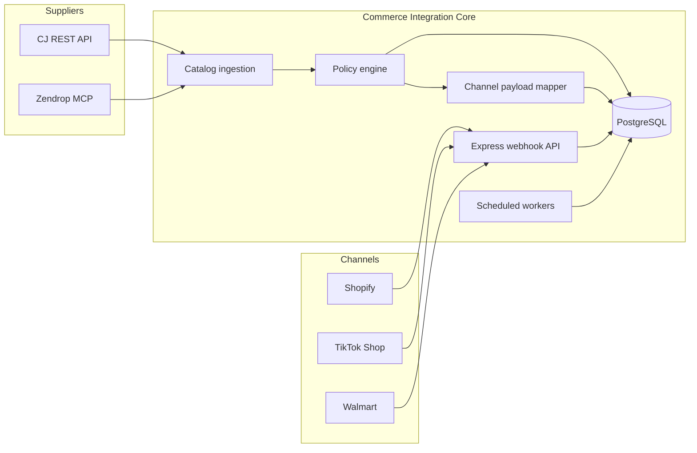
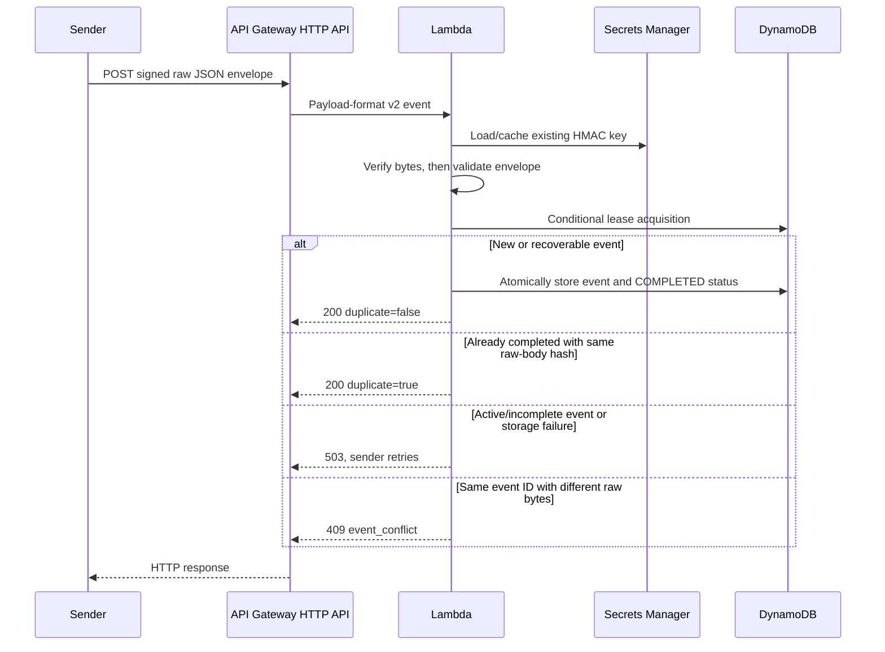

# Architecture

Commerce Integration Core is a TypeScript backend that normalizes supplier catalog data, applies channel-specific eligibility rules, persists a canonical commerce model in PostgreSQL, accepts authenticated webhooks, and monitors fulfillment deadlines.

## System overview

## Runtime components

| Component | Responsibility |
|---|---|
| `src/index.ts` | Express health/webhook server and cron registration |
| `src/connectors/` | Supplier adapters, retry/backoff, normalized domain types |
| `src/policy/` | Catalog eligibility and fulfillment-SLA rules |
| `src/database/` | PostgreSQL connection management and persistence helpers |
| `src/workers/` | Inventory synchronization and SLA monitoring |
| `src/webhooks/` | HMAC verification, deduplication, and inbound event handling |
| `src/enrichment/` | Optional listing-copy and catalog-scoring helpers |
| `sql/schema.sql` | Canonical catalog, inventory, listings, orders, webhook events, and job state |

## Data flow

1. Supplier connectors normalize external catalog and inventory responses into shared product/variant types.
2. The policy layer evaluates origin, stock, transit time, packaging, and channel requirements.
3. PostgreSQL stores canonical products, variants, inventory snapshots, and channel-specific listing payloads.
4. Webhook routes validate signatures before recording events and use unique external IDs for idempotency.
5. Scheduled workers process inventory refreshes and inspect open fulfillment watches.
6. Operational state is persisted so worker restarts do not depend on in-memory history.

## Reliability and security

- External HTTP calls use retry/backoff behavior and honor `Retry-After` when present.
- Webhook verification uses HMAC and timing-safe comparison.
- Event and order uniqueness constraints prevent duplicate processing.
- Configuration is validated with Zod and credentials are read from environment variables.
- External supplier integrations are disabled by default in `.env.example`.
- Structured logs avoid embedding credentials and include operational context for failures.

## Scope

The repository implements catalog normalization, policy evaluation, persistence, webhook handling, payload preparation, and SLA monitoring. It intentionally does not enable live marketplace publishing or supplier purchasing by default.

## Additive serverless intake

The AWS extension is a separate persistence boundary for canonical `order.created` notifications:

`src/serverless/handler.ts` reuses the original timing-safe base64 HMAC verifier without importing the Express server, its configuration loader, cron jobs, or PostgreSQL pool. The endpoint uses a custom `x-commerce-signature` header and canonical signed envelope; an adapter is required for native marketplace messages.

The DynamoDB partition key is the signed UUID. A 30-second owner-fenced lease protects incomplete work, and a single atomic completion update stores the validated event. Failures remain retryable; a row's mere existence never proves completion. Completed records have a seven-day TTL, while failed/incomplete records remain available for recovery. This design performs durable intake only and has no relational bridge or external order side effect.

The [serverless guide](SERVERLESS.md) explains IAM scope, secret caching, retry outcomes, replay boundaries, deployment approval, cost/cleanup considerations, local testing, and the differences from the original long-running Express/PostgreSQL architecture.
