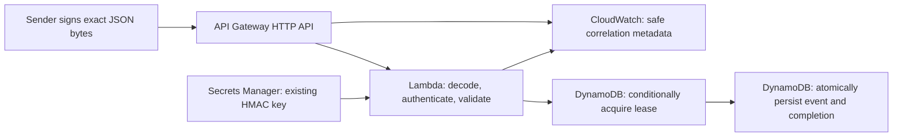

# AWS serverless webhook extension

The original application is an Express service with PostgreSQL persistence, supplier connectors, channel-specific webhook routes, and scheduled workers. The additive serverless extension accepts one canonical order notification over HTTPS and stores it in DynamoDB. It does not place supplier orders, publish marketplace listings, or copy events into PostgreSQL.

**Live AWS deployment is pending explicit approval.** Local source, tests, packaging, and template validation do not prove that an AWS account deployment works. See [validation evidence](VALIDATION.md) for commands actually executed in this task.

## Request flow and scope



API Gateway exposes `POST /webhooks/orders` and sends a payload-format v2 event to the TypeScript Lambda handler. Lambda decodes any API Gateway base64 transport representation, verifies the signature over the resulting raw bytes, validates JSON, acquires the event's lease, and durably stores the validated event. A `200` response means that event is stored or that the same event was already completed.

Lambda fits this bounded request-driven workload without an always-running web server. The HTTP API supplies HTTPS routing and throttling. DynamoDB supplies per-item conditional writes without a relational connection pool. The original Express/PostgreSQL application remains the richer commerce backend; this extension is a separate intake path, with its own persistence and lifecycle.

This is a custom signed envelope, not a native Shopify, TikTok Shop, Walmart, or CJ webhook endpoint. A sender or trusted adapter must produce the following contract:

```json
{
  "id": "7ef66f69-f977-4c45-a872-09f219f65589",
  "type": "order.created",
  "occurredAt": "2026-10-30T12:00:00Z",
  "data": {
    "orderId": "ORDER-1001"
  }
}
```

| Field or header | Contract |
| --- | --- |
| `Content-Type` | `application/json`, optionally `; charset=utf-8` |
| `x-commerce-signature` | Canonical base64 HMAC-SHA256 digest: 44 characters, ending in `=` |
| `id` | UUID, included inside the signed body; preserve the same identity and bytes for retries |
| `type` | Exactly `order.created` |
| `occurredAt` | ISO datetime in UTC with a `Z` suffix |
| `data.orderId` | String, trimmed and validated to 1–128 characters |
| JSON structure | No additional envelope or data fields; request body at most 128 KiB |

The handler rejects missing or ambiguous required headers, invalid base64 transport, invalid UTF-8, malformed JSON, missing identifiers, and invalid fields. `occurredAt` describes the event; it does not impose a freshness window.

## Authentication and replay boundaries

The sender computes `base64(HMAC-SHA256(secret, exactRequestBodyBytes))`. Lambda reuses the repository's existing `verifyShopifyHmac` implementation for this base64 HMAC algorithm; the custom endpoint does not otherwise use Shopify's payload or headers. The verifier compares equal-length digests with `timingSafeEqual`. The handler first checks the signature's canonical base64 format and verifies the HMAC before parsing JSON or writing to DynamoDB.

For example, sender code can construct the bytes once and use them for both signing and transmission. Here `secret`, `webhookUrl`, and `event` come from the sender's secure configuration and validated input:

```typescript
import { createHmac } from "node:crypto";

const rawBody = Buffer.from(JSON.stringify(event), "utf8");
const signature = createHmac("sha256", secret).update(rawBody).digest("base64");
await fetch(webhookUrl, {
  method: "POST",
  headers: { "content-type": "application/json", "x-commerce-signature": signature },
  body: rawBody,
});
```

The sender must inspect the response and retain `rawBody` for retries; the snippet only illustrates signing and transmission.

Whitespace, JSON property order, and UTF-8 bytes affect the signature and stored SHA-256 payload hash. Retrying an event requires resending the original bytes; parsing and reserializing an equivalent object can cause an identity conflict. The signed event ID prevents a replay from gaining a new identity merely by changing an unsigned header.

HMAC authenticates possession of a shared key and message integrity. It does not encrypt the body; HTTPS provides transport encryption. Anyone holding the shared key can submit accepted events. Use a separate high-entropy key for this endpoint, restrict access to it, and avoid including unnecessary personal data in notifications.

Completed records have a seven-day DynamoDB TTL. Deletion is asynchronous, so an existing completed record still deduplicates after its TTL until DynamoDB removes it. After deletion, an old correctly signed body can be accepted again. This implementation has no signed timestamp freshness enforcement, permanent replay ledger, or overlapping rotation-key support. Those would be separate security and retention decisions.

## Idempotency, partial work, and retries

The table has one string partition key, `id`, containing the signed event UUID. A row also records `payloadHash`, `status`, timestamps, and either a lease owner or a completed event.

1. `acquire` conditionally creates a `PROCESSING` row with a unique owner and a 30-second lease. It can reclaim a `FAILED` row or an expired `PROCESSING` lease only when the payload hash matches.
2. If acquisition loses a conditional-write race, a strongly consistent read distinguishes a completed duplicate, an active/incomplete event, or reused identity with different content.
3. `complete` checks status, owner, hash, and unexpired lease. A single atomic update stores the validated event and changes status to `COMPLETED`, then removes the lease and sets the seven-day TTL.
4. On a caught failure, `fail` conditionally marks only the current owner's `PROCESSING` row as `FAILED`. A stale invocation cannot release another owner's lease or undo a completion.

The 30-second lease exceeds the configured 10-second Lambda timeout. A crash before completion can therefore be recovered by a later sender retry after expiry. If completion succeeds but its acknowledgement is lost, the response can be `503`; a retry finds `COMPLETED` and safely returns a duplicate acknowledgement. If cleanup also fails, the existing lease expires. Failed/incomplete rows have no TTL so they remain recoverable and need operational review if a sender never retries.

Completion consists entirely of storing the event. There is no external side effect between the two writes. Adding payment, order placement, or delivery to another system would require a separate idempotent consumer or transactional outbox design; the lease alone does not provide exactly-once effects across services.

| HTTP result | Meaning and sender action |
| --- | --- |
| `200`, `duplicate: false` | Event was durably stored |
| `200`, `duplicate: true` | Identical event was already completed |
| `400`, `invalid_request` | Correct the JSON or contract; missing body and invalid transport also fail safely |
| `401`, `invalid_signature` | Correct the signature/key; no body or secret details are disclosed |
| `409`, `event_conflict` | This event ID has different raw bytes; resend original bytes, or use a new signed ID for an actually different event |
| `413`, `payload_too_large` | Reduce the request body |
| `415`, `unsupported_media_type` | Supply the required JSON content type |
| `503`, `temporarily_unavailable` | Retry; response includes `Retry-After: 5` |

The handler also returns `405` for unsupported event methods/formats. API Gateway may reject an unmatched route before Lambda runs. Gateway throttling or Lambda timeouts can produce platform responses such as `429` or `5xx` instead of the handler's JSON. The sender must retry transient failures and uncertain acknowledgements with bounded exponential backoff, jitter, and the same body bytes. API Gateway's synchronous HTTP invocation does not create a durable retry queue. There is no automatic recovery when the sender stops retrying.

## Source and infrastructure

| File | Responsibility |
| --- | --- |
| `src/serverless/event.ts` | Strict canonical envelope schema and type |
| `src/serverless/handler.ts` | API Gateway v2 boundary, authentication, validation, responses, safe logging |
| `src/serverless/store.ts` | DynamoDB conditional writes, owner fencing, retries, completion |
| `src/serverless/secret.ts` | Bounded Secrets Manager key cache and safe configuration validation |
| `src/serverless/*.test.ts` | Unit coverage of request, storage, and secret behavior |
| `template.yaml` | SAM API, Lambda, table, role, and log resources |
| `Makefile` | SAM custom build target that packages only the Lambda bundle |
| `samconfig.toml` | Example stack name and deployment confirmation defaults |

The SAM template uses Node.js 22, 256 MiB memory, a 10-second timeout, and reserved concurrency of five. HTTP API defaults limit requests to five per second with a burst of ten. The DynamoDB table uses on-demand billing, encryption, point-in-time recovery, and TTL on `expiresAt`. It is retained on stack deletion/replacement. Both log groups retain records for 14 days while they exist.

The runtime role allows only `dynamodb:GetItem` and `dynamodb:UpdateItem` on this table, `secretsmanager:GetSecretValue` on the supplied secret ARN, and log stream creation/writes in this Lambda's log group. It has no table-scan, table-delete, unrelated-secret, or general account permissions. The deployment identity separately needs permission to create/update the SAM stack and its resources; runtime IAM is not deployment IAM.

## Configuration and secret handling

| Variable or parameter | Source |
| --- | --- |
| `WEBHOOK_TABLE_NAME` | SAM sets this to the new table name |
| `WEBHOOK_SECRET_ARN` | SAM sets this from the required `WebhookSecretArn` parameter |
| `LOG_LEVEL` | SAM configures `info`; application emits approved structured metadata |
| `WebhookSecretArn` | Full ARN of an existing Secrets Manager secret, supplied at approved deployment |

The secret must be raw text with at least 32 characters and at most 4096 UTF-8 bytes. JSON and binary secret values are unsupported. Generate a cryptographically random key, store it securely, and share it with the authorized sender through an approved secret channel. Do not commit it, place it in `samconfig.toml`, paste it into a PR, or pass its value in deployment command arguments. Deployment takes a secret ARN, not the secret value.

The template assumes the secret uses the AWS managed Secrets Manager key. A customer-managed KMS key would need additional narrowly scoped decrypt access and review. Warm Lambda instances cache the fetched key for at most 60 seconds and share simultaneous cache misses. A failed refresh does not extend the expired key's lifetime. Rotation can briefly cause signature failures while instances refresh; coordinate sender switching and retries because the implementation does not accept both old and new keys simultaneously.

The Lambda handler does not load the original application's `.env` or require PostgreSQL, supplier credentials, or an AWS key in source. AWS supplies runtime credentials through the execution role.

## Local installation and checks

From the repository root, using Node.js 22+:

```bash
npm ci
npm run typecheck
npm test
npm run build
npm run build:serverless
sam validate --lint
sam build
```

AWS SAM CLI, Make, and the repository's npm dependencies are required for SAM packaging. These commands do not deploy resources. `npm test` includes the preserved original tests and the serverless unit tests. `npm run build` builds the existing TypeScript project; `build:serverless` separately bundles the Lambda entry point. SAM uses the Makefile to place `index.mjs` in the function artifact directory. Dependencies needed by the handler are bundled rather than assumed to be available in AWS's runtime SDK.

In a managed cloud task with a read-only home directory, SAM may need a writable application directory. The validation run used `SAM_CLI_TELEMETRY=0`, `__SAM_CLI_APP_DIR=/tmp/commerce-sam-config`, `AWS_EC2_METADATA_DISABLED=true`, and `AWS_DEFAULT_REGION=us-east-1` for local SAM commands. The region supplies template-validation context; it does not select or authorize an AWS account. See the recorded validation commands for the task-local CLI installation path. These are local tool settings, not Lambda credentials or deployment approval.

For real conditional-write behavior against a disposable local DynamoDB process:

```bash
docker run --rm --name commerce-dynamodb-local \
  -p 127.0.0.1:8000:8000 amazon/dynamodb-local \
  -jar DynamoDBLocal.jar -inMemory -sharedDb
```

In another terminal, from the repository root:

```bash
DYNAMODB_LOCAL_ENDPOINT=http://127.0.0.1:8000 npm run test:serverless:integration
DYNAMODB_LOCAL_ENDPOINT=http://127.0.0.1:8000 npm run serverless:local
```

The local helper generates a signed fixture and invokes the same handler factory with a local test key, explicit dummy DynamoDB credentials, and the local endpoint. It does not fetch a secret or contact a personal AWS account. The integration suite exercises actual DynamoDB Local commands, while the unit tests inject service failures. Stop the foreground container with Ctrl-C; its in-memory data is disposable. Use an unused port if another service already occupies 8000 and update the endpoint accordingly.

This path tests the application and DynamoDB protocol locally. It does not emulate API Gateway, real IAM enforcement, AWS Secrets Manager, CloudWatch delivery, DynamoDB TTL cleanup, or managed-service availability. `sam local invoke` is not configured as an account-free smoke test: the production entry point intentionally uses Secrets Manager and AWS DynamoDB. Do not run it with personal credentials to bypass deployment approval.

## Deployment after approval

Before deployment, agree on the AWS account, region, stack name, sender, retention policy, costs, and existing secret. Stack names must be at most 56 characters because the Lambda name appends `-webhook`. The included `commerce-webhook-dev` value satisfies this limit. Confirm the secret's region/account and encryption policy match the deployment plan.

Only after approval:

```bash
sam validate --lint
sam build
sam deploy --guided --region '<approved-region>' \
  --parameter-overrides WebhookSecretArn='<existing-secret-arn>'
```

Review the CloudFormation changeset, IAM capability, artifact bucket creation, and displayed resources before confirming. The provided config enables changeset confirmation and does not disable rollback. `resolve_s3` can create a SAM-managed artifact bucket; that is an external account change as well. Never use real secret values as parameter overrides.

The stack outputs the HTTPS webhook URL, table name, and log group names. After an approved deployment, verify a signed event, repeat the same bytes, check the stored completed row, submit an invalid signature, and inspect safe CloudWatch logs. Only those checks can establish live deployment behavior. Do not describe local mocks or packaging as evidence of AWS success.

## Security, charges, and monitoring

The endpoint is public and authenticates with HMAC at the Lambda boundary. It has no user login, IP allowlist, WAF, or tenant-specific key separation. Throttling and reserved concurrency reduce load but are not spending caps; rejected requests can still incur API Gateway/Lambda charges, and syntactically valid signatures can cause Secrets Manager lookups. Consider budgets and alarms before exposure to an untrusted sender population.

Expected charge categories are HTTP API requests, Lambda requests and execution duration, DynamoDB reads/writes/storage, point-in-time recovery, CloudWatch log ingestion/storage, Secrets Manager storage/API calls, and SAM artifact bucket storage. Retained tables continue to incur applicable storage/backup charges after stack deletion. Actual charges depend on region, volume, payload size, retention, and current pricing; no fixed monthly estimate is implied. There is no always-running server or NAT gateway in this template.

Application logs contain `requestId` (Lambda invocation), `gatewayRequestId` (HTTP API request), `eventId` after successful validation, `stage`, level, and a fixed message. They intentionally omit request bodies, signatures, secret values, raw exceptions, and AWS service responses. Access logs contain HTTP API request IDs and route/status metadata. Some validation rejections return early without application logs; use access-log status counts for those requests. Export only the metadata needed for investigation.

Example CloudWatch Logs Insights query for the Lambda group:

```text
fields @timestamp, requestId, gatewayRequestId, eventId, stage, message
| filter eventId = "7ef66f69-f977-4c45-a872-09f219f65589"
| sort @timestamp asc
```

Depending on Lambda's JSON console wrapping, application fields can appear inside a `message` JSON value instead of as top-level discovered fields; inspect one record and parse that value before applying the same filters. Use `gatewayRequestId` to join an access-log investigation to the application record and `requestId` for a specific Lambda invocation. `stage=acquire` points to receipt/conditional-write work, `stage=complete` to final persistence, and `stage=secret` to key retrieval or signature checking. Investigate recurring `503` responses and stale failed/processing rows with read-only tooling before changing data. Do not delete a row merely to make a duplicate succeed.

## Teardown after separate review

Capture the table output and decide whether events must be retained. After approval to remove the deployment:

```bash
sam delete --stack-name commerce-webhook-dev --region '<approved-region>'
```

The table is intentionally retained. It must be reviewed and deleted separately only when its event and recovery data are no longer needed:

```bash
aws dynamodb delete-table --table-name '<retained-table-name>' \
  --region '<approved-region>'
```

The latter command is destructive and requires its own deliberate approval. Stack deletion removes the stack-managed log groups; export required diagnostic records before deletion under the applicable retention policy. The pre-existing secret is not owned by this stack and is not deleted. Review it separately, including any other consumers and recovery requirements. Review leftover deployment artifacts and SAM-managed bucket lifecycle; do not empty a shared bucket indiscriminately.

## Existing follow-up issues and future work

The original application's known setup issues remain separate: supplier flags coerce the string `"false"` to true, the schema migration cannot safely rerun and the container schema mount had permission limitations, and `npm start` targets `dist/index.js` while the TypeScript build emits `dist/src/index.js`. The environment setup script keeps TLS verification, does not overwrite an existing `.env`, and checks for the schema before migration. Local `.env`, generated bundles, SAM output, and credentials must remain untracked. None of these original application behaviors is silently changed by the extension.

Other limitations are the single event type, shared-key single sender trust model, exact-byte retry requirement, finite replay retention, no queue or downstream consumer, no automatic stale-row maintenance, and no overlapping-key rotation. Future work can add approved event types, a signed freshness policy, observable retry queues, alarms, retention controls, and downstream delivery with an explicit idempotency contract. These are not prerequisites for durable intake and are not claimed as implemented.

## Learning walkthrough

For an interview, explain the implementation in this order:

1. A sender signs a canonical envelope containing its immutable event ID. API Gateway routes the HTTPS request and supplies a v2 event; Lambda returns a status, headers, and JSON body that Gateway sends to the caller.
2. The handler verifies the original bytes with a Secrets Manager key before trusting JSON fields. Re-serializing JSON first would authenticate different bytes.
3. DynamoDB's conditional update chooses one lease owner. A consistent read after a rejected condition distinguishes a finished duplicate from unfinished work; an existing row is not automatically success.
4. The owner's second atomic update saves the validated notification and marks completion. Owner/hash/lease conditions prevent stale invocations from finishing another invocation's work.
5. Crashes and unknown write outcomes return to sender-driven retries. Failed rows can be retried, abandoned leases expire, and completed rows acknowledge duplicates. No external commerce action is presented as exactly-once.
6. The execution role permits only the necessary table, secret, and log actions. Structured correlation fields support diagnosis without recording credentials or payloads.

The implementation and its initial verification were AI-assisted. Running the commands yourself, examining the conditional expressions, and tracing a first event, duplicate, and retry are ways to independently verify and understand it. Do not present AI-run checks or a future deployment as work you personally performed.

Short quiz:

1. Why must an identical retry preserve JSON whitespace as well as event ID?
2. Why does an unexpired `PROCESSING` row return a retryable failure instead of a duplicate success?
3. What happens if the completion write succeeds but Lambda does not receive its acknowledgement?
4. Does the Lambda role permit deleting the table or reading every secret in the account?
5. Can a valid signed event be replayed after DynamoDB removes its completed TTL row?
6. Would adding a supplier purchase call between lease acquisition and completion preserve exactly-once purchasing?

Answers: (1) The HMAC and identity hash cover exact raw bytes. (2) Its payload may not have been durably completed. (3) A later retry reads `COMPLETED`; cleanup cannot revert it. (4) No; resources and actions are scoped. (5) Yes; there is no permanent replay ledger or freshness check. (6) No; cross-service side effects need their own durable idempotency/recovery design.
