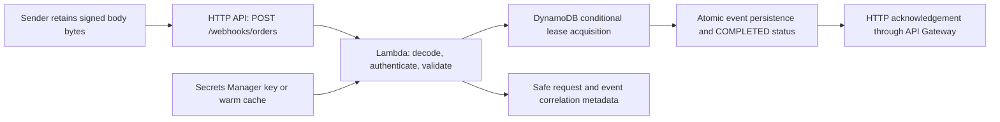

# AWS serverless engineering study guide

This is a living learning journal and review checklist for this repository.
It supplements [SERVERLESS.md](SERVERLESS.md), the implementation reference;
[ARCHITECTURE.md](ARCHITECTURE.md), the system design; and
[VALIDATION.md](VALIDATION.md), the preserved verification history. Read those
documents for the full protocol, deployment commands, and operating procedures.

**AWS deployment: PENDING APPROVAL.** All exercises here use source inspection,
synthetic data, injected failures, or disposable local DynamoDB tables. Do not
use personal AWS credentials, customer data, or production resources.

Reviewed source snapshot: [`c6df4b1e67dd10e04aca786bb47da700ef929c33`][snapshot],
October 30, 2026 (America/Denver). Source/test links below are pinned to that
commit so their line numbers remain accurate. The review started at `ff5f894`;
the small bootstrap correction is recorded under [review results](#engineering-review-results).
No learner explanation or completed exercise has yet been supplied.

## How to use and maintain this record

1. Study one topic in the order below. Read its linked function and named test,
   predict the result, then attempt the exercise before opening the answer key.
2. Record your prediction, command or source trace, observed result, and remaining
   question. A passing automated test alone is evidence about software, not proof
   that you can explain its behavior.
3. During teaching, the tutor asks questions and waits for your attempt. If needed,
   offer hints progressively: identify the relevant function, point to the
   condition/state, then ask for a revised prediction. Give a full solution only
   after your attempt or when you request it. Do not advance topics automatically.
4. At the end of each session, update only demonstrated progress and append a
   dated log entry with your actual answers and activities. Reading, trying an
   exercise with help, and independently explaining it are separate achievements.
5. When code changes, review the affected claims/tests, update the snapshot and
   links, and keep earlier session observations dated. Do not rewrite historical
   results in `VALIDATION.md`. Commit and push journal changes on the feature
   branch when authorized; if persistence is unavailable, provide the exact
   Markdown patch for the learner to save.

Statuses mean: **Not confirmed** = reading has not been reported; **Not attempted**
= no learner attempt has been observed; **NOT YET DEMONSTRATED** = no independent
learner explanation or reproduction has been observed. AI-generated code and
AI-executed checks never advance these statuses.

## Reading path and source map

| Teaching order | Read in this repository | Functions/contracts to follow | Review topics |
| --- | --- | --- | --- |
| 1. Overall architecture and lifecycle | [Architecture](ARCHITECTURE.md#additive-serverless-intake), [request path][request], [completion][complete] | `createWebhookHandler`, `acquire`, `complete`, `fail` | G, then the whole request map |
| 2. Handler and authentication | [Raw body][raw-body], [authentication][auth], [existing verifier][hmac] | `rawBody`, `header`, `verifyShopifyHmac`, `safeEqual` | A, B |
| 3. Payload validation | [Schema][schema], [parse boundary][validation] | `webhookEventSchema`, `safeParse`, fatal UTF-8 decoder | Payload exercise below |
| 4. DynamoDB state transitions | [Acquisition][acquire], [completion][complete], [failure][failure] | `createEventStore`, `acquire`, `complete`, `fail` | C, D, E, F, K |
| 5. Secret handling | [Provider][secret], [bootstrap][bootstrap] | `createSecretProvider`, cache, in-flight promise, `handler` | H |
| 6. AWS resources | [SAM resources][table], [role][iam], [API/function][api] | `WebhookTable`, `WebhookRole`, `WebhookApi`, `WebhookFunction` | I, J |
| 7. Local verification | [Handler tests][handler-tests], [store tests][store-tests], [secret tests][secret-tests], [integration][integration], [local helper][local] | Injected boundaries versus real local commands | L |
| 8. Deployment and operations | [Operating guide](SERVERLESS.md#deployment-after-approval), [retention][table], [safe logs][logging] | Approval, changeset, monitoring, teardown inventory | H, I, J, K |

### Request map to annotate yourself



The real Lambda entry point is `handler`; tests usually call
`createWebhookHandler` with injected boundaries. An API Gateway event contains
the HTTP body/headers and request context; the separate Lambda `Context` contains
the invocation ID. The returned `statusCode`, headers, and serialized `body`
become the HTTP response. Local fixtures imitate that shape; they do not run
managed API Gateway.

## Engineering review results

The focused review inspected source, tests, and documentation for A–L. It did
not find a material HMAC, DynamoDB fencing, or scoped-IAM defect. Review questions
and missing live evidence were not treated as proof that the design is broken.

| Finding | Evidence and classification | Action |
| --- | --- | --- |
| R1: blank bootstrap configuration | At the [original entry point][old-bootstrap], truthiness admitted a whitespace-only secret reference. `createSecretProvider` rejects it before the factory's catch is active, so initialization could reject instead of returning safe `503`. Reproduced locally without an SDK request. SAM's parameter pattern excludes this value: a low-severity manual-configuration correctness defect, not an authentication bypass. | Reject trim-empty table/secret settings at [the entry point][bootstrap]; added [regression test][bootstrap-test] for missing/blank settings. No original application changes. |
| R2: application level is not platform severity evidence | The production adapter uses `console.log` for all application levels. `LOG_LEVEL` appears in the template but is not read by the serverless code. Injected log tests do not prove CloudWatch filtering or field shape. | Record an observability limitation. Do not claim configurable filtering or assume embedded `level: error` means platform ERROR severity. No redesign. |
| R3: ambiguous acquisition acknowledgement coverage | Source sets `acquired` only after `acquire` returns. If acquisition committed but its acknowledgement was lost, later retries may be busy until lease expiry. | Safe recovery follows from the conditions; no dedicated committed-acquisition/lost-ack test exists. Do not confuse this with the tested completion-ack case. |
| R4: bounded replay and sender-driven recovery | TTL removal permits later acceptance; no freshness condition or durable retry queue exists. | Documented limitations, not newly verified defects. Failed rows retain recovery metadata, not an already-completed notification. |

### Documentation, source, test, and verification boundaries

Each row is a review checklist item. Checking it requires the learner to justify
all four evidence columns; no item is currently marked complete.

| Topic | Documentation currently claims | Source actually establishes | Existing tests establish | Still requires independent/live verification; verdict |
| --- | --- | --- | --- | --- |
| [ ] A. Raw HMAC | [Authentication reference](SERVERLESS.md#authentication-and-replay-boundaries): authenticate exact bytes before JSON. | [Raw body][raw-body] → canonical signature check → [verifier][hmac] → [JSON/schema][validation]. Equal-length digests use `timingSafeEqual`. | [Handler authentication cases][handler-auth-tests] exercise valid, missing, tampered, wrong-format/length signatures and base64 transport; [invalid UTF-8 case][utf8-test]. | No timing measurements or real Gateway transport test. Canonical pad-bit check is source-established without its own dedicated case. No bypass found. |
| [ ] B. Byte-preserving retries | Same identity and original bytes must be retained. | [SHA-256 raw-body hash][validation] binds deduplication to byte content, separately from HMAC authentication. | [Changed byte with old signature][byte-test] fails auth; [re-signed changed payload][conflict-test] reaches `409`. | The conflict integration case changes `orderId`, not just whitespace; whitespace-only conflict follows from raw hashing. Deliberate contract. |
| [ ] C. Conditional idempotency | [Retry reference](SERVERLESS.md#idempotency-partial-work-and-retries): existing row alone is not success. | [Conditional update and consistent read][acquire] distinguish acquired, completed duplicate, busy, and hash conflict. | [Store command tests][store-tests] inspect conditions; [real local race][race-test] admits one owner and keeps unfinished work retryable. | Real AWS availability/authorization and learner reproduction remain unverified. No correctness defect found. |
| [ ] D. Lease and timeout | 30-second lease exceeds the configured 10-second function timeout. | [Epoch-second lease][acquire], [function timeout][api]; expiry is data checked by a later request, not a timer that runs work. | [Lease constant assertion][lease-test] checks `now + 30`; local expiry tests advance an injected clock by 31 seconds. | No measured Lambda timeout, cross-instance clock behavior, or real network deadline test. Designed recovery policy. |
| [ ] E. Recovery and fencing | Expired work can be reclaimed; stale owners cannot overwrite successors. | [Acquire][acquire] checks expiry/hash; [complete][complete] checks status/owner/hash/live lease; [fail][failure] checks status/owner. | [Local takeover and expired-owner cases][takeover-test], [stale cleanup condition][stale-test]. | Fencing applies to these writes, not hypothetical supplier calls. No defect found. |
| [ ] F. Failures and uncertain outcomes | Caught failures return retryable errors; lost completion acknowledgements are recoverable. | [Handler catch][handler-failure] and [atomic completion][complete] preserve this boundary; acquired flag gates cleanup. | [Failure/retry and lost-ack cases][retry-tests], [local lost-ack and failure tests][ack-test], service-error cases in store tests. | Faults are injected/simulated, not real packet loss. Acquisition-commit/lost-ack lacks a dedicated test. No queue; design limitation. |
| [ ] G. Durable intake versus ordering | The extension accepts a notification; it does not place an order or bridge PostgreSQL. | [Event contract][schema], [completion write][complete], no supplier/SQL call in the request path. | [Persisted event equality][persistence-test] and [handler completion boundary][handler-auth-tests]. | Tests do not prove downstream commerce processing; none is implemented. Scope boundary. |
| [ ] H. Secrets and safe logging | [Secret reference](SERVERLESS.md#configuration-and-secret-handling): role-based retrieval, cache up to 60 seconds, no overlapping rotation keys. | [Provider][secret] validates raw text bounds, shares fetches, expires cache, does not serve an expired key after failed refresh; [safe fields][logging]. | [Cache/rotation/failure/coalescing tests][secret-tests], [sanitization cases][sanitization-tests], [bootstrap regression][bootstrap-test]. | Mocked retrieval is not real Secrets Manager access or rotation. R1 corrected; single-key rotation and logging nuances remain limitations. |
| [ ] I. IAM, routing, correlation | [Infrastructure/log reference](SERVERLESS.md#security-charges-and-monitoring): scoped role and request/event fields. | [IAM][iam] scopes table/secret/log writes; [API][api] declares POST v2; [logs][logging] emit Lambda ID, Gateway ID, validated event ID, stage. | Handler tests inspect injected IDs and sanitized records; local fixture uses v2 shape. Static template review establishes intended permissions. | No unit test proves live IAM allow/deny, Gateway routing, invocation permission, CloudWatch delivery/severity. R2 is an operational limitation. |
| [ ] J. Resources, costs, cleanup | On-demand encrypted table, PITR, table retained on delete/replacement, 14-day log events, approval-gated cleanup. | [Table/log groups][table] and [SAM config][samconfig] declare these properties; external secret is referenced, not created. | Historical SAM lint/build evidence; current static lint below. No deployed resource assertion test. | Actual PITR/restore, retained-resource inventory, quotas and charges need approved AWS verification. Template retention is not proof that cleanup ran. |
| [ ] K. Asynchronous TTL and replay | Seven-day completed TTL is finite replay protection; failed rows have no TTL. | [Completion][complete] sets expiry; [duplicate read][acquire] honors existing completed rows even past expiry; absent IDs can acquire with no freshness check. | [Expired-but-present receipt test][ttl-test], expiry attribute and failed-row assertions in [local cases][ack-test]. | Actual TTL deletion/replay-after-deletion not exercised. Finite retention is a documented security tradeoff. |
| [ ] L. Evidence levels | [Validation history](VALIDATION.md) separates local checks and pending AWS behavior. | [Helper guard][local] forces loopback/dummy credentials; [integration setup][integration] skips database suite without endpoint. | Unit mocks exercise failures; local DB exercises expressions; SAM checks syntax/packaging. | Learner competence, deployed authorization/transport/monitoring, load behavior, and current remote CI remain separate claims. No evidence inflation. |

## Safe exercise commands

Run from the repository root with installed dependencies and Node.js 22+:

```bash
# U: all original and serverless unit tests; no AWS credentials required.
npm test

# H / S / SEC: focused handler / store / secret unit files.
node --import tsx --test src/serverless/handler.test.ts
node --import tsx --test src/serverless/store.test.ts
node --import tsx --test src/serverless/secret.test.ts

# D / M: real local expressions / signed local demo, only after local DB is ready.
DYNAMODB_LOCAL_ENDPOINT=http://127.0.0.1:8000 npm run test:serverless:integration
DYNAMODB_LOCAL_ENDPOINT=http://127.0.0.1:8000 npm run serverless:local
```

For starting disposable DynamoDB Local, use the
[existing local instructions](SERVERLESS.md#local-installation-and-checks).
The helper creates/deletes only its unique temporary table and generates a local
key without printing it. Never substitute a remote endpoint or personal credentials.
An integration run without `DYNAMODB_LOCAL_ENDPOINT` skips database work; inspect
executed test names and skipped counts. A command exiting zero is insufficient
if the intended case did not run.

## Topic exercises

These exercises are assigned, not recorded as completed. An expected observation
is a check on the exercise, not a statement that the learner already achieved it.

### G first: architecture and what success means

**Concept and purpose.** Durable intake means remembering a validated notification
so repeated delivery can be handled predictably. It does not mean a supplier
accepted an order. Follow [request handling][request] → [acquire][acquire] →
[complete][complete] → HTTP acknowledgement. The original Express server and its
PostgreSQL/cron workflow are separate; no bridge is called here.

**Review questions:** What information arrives through API Gateway versus Lambda
`Context`? What exact operation must finish before a new event gets `200`?

**Exercise G1:** Without running anything, annotate the request map with the function
that authenticates, the function that stores the event, and the point that returns
the response. Explain what a sender may conclude from that response.

**Verification criterion:** Cite actual calls/conditions, distinguish request IDs
from the signed event ID, and avoid claiming a supplier order was placed. Then
use the named persisted-event test to check your trace.

**Troubleshooting variation:** A sender receives `200` but finds no PostgreSQL row.
Locate the declared persistence boundary before deciding this is a defect.

**Interview target:** Give a 60-second lifecycle explanation and state one thing
the success response does not guarantee. This is the first interactive exercise.

### A: authenticate raw bytes before trusting fields

**Concept and purpose.** HMAC is a keyed integrity check. [The handler][auth]
validates the header's canonical base64 form, fetches the key, and calls the
[existing verifier][hmac] on bytes obtained by `rawBody`. Only afterward does
fatal UTF-8 decoding and JSON/schema validation occur. A valid digest does not
make an invalid payload acceptable.

**Review questions:** Why compare equal-length digests with `timingSafeEqual`?
How does base64 HTTP transport differ from a base64 HMAC signature?

**Exercise A1:** Predict results for the valid exact-byte, changed-byte/old-signature,
and malformed-signature cases in H. Run H and identify those cases by name.

**Expected observation:** They complete with their asserted acceptance/rejection
and do not reach storage on authentication failure; the run is not a timing study.

**Troubleshooting variation:** Correctly sign malformed JSON in the test harness.
Trace which validation boundary rejects it and whether storage is called.

**Interview target:** Explain the order of decoding, authentication, and parsing,
and why HMAC provides integrity rather than encryption.

### B: preserve original bytes on every retry

**Concept and purpose.** JSON objects can be equivalent while their serialized
bytes differ. Authentication and [the stored payload hash][validation] both use
raw bytes. Reformatting before retransmission can therefore break authentication
or create an identity conflict.

**Review questions:** What changes if the sender keeps the old signature after
adding whitespace? What changes if it correctly re-signs the altered body?

**Exercise B1:** Compare [the changed-byte handler case][byte-test] with
[the re-signed payload conflict case][conflict-test]. Run H and D, then write a
four-row prediction table: first request, identical retry, changed bytes with old
signature, changed bytes with a new valid signature and the same ID.

**Expected observation:** Find the assertions for authentication failure versus
identity conflict. State that the existing integration mutation changes a field;
whitespace-only conflict is a source-derived conclusion, not that exact test.

**Troubleshooting variation:** Your sender generates a new `occurredAt` on retry.
Identify which original bytes should instead be retained.

**Interview target:** Explain why retaining only an event ID and a parsed object
is insufficient for this retry contract.

### Payload validation: authenticate does not mean accept

**Concept and purpose.** [The strict schema][schema] requires a signed UUID,
`order.created`, a UTC datetime, and a trimmed nonempty order ID of at most 128
JavaScript string units. Both objects reject unknown fields. It does not enforce
event freshness or verify that an order exists in a commerce system.

**Review questions:** Can a validly signed `null` be accepted? Is `occurredAt`
freshness the same property as datetime syntax?

**Exercise V1:** Trace the signed malformed-JSON and missing-ID cases in H from
HMAC through `safeParse`. Predict storage call counts, then run H.

**Expected observation:** Invalid authenticated payloads receive the asserted safe
request error and never acquire a receipt. Distinguish documented schema rules
from rules with dedicated tests; nested unknown fields rely on `.strict()` here.

**Troubleshooting variation:** An event has an order ID surrounded by spaces.
Compare the signed raw body with the validated value passed to completion.

**Interview target:** Separate authentication, structural validation, normalization,
business validation, and timestamp freshness.

### C: one conditional write selects the owner

**Concept and purpose.** A read-then-write check can race. [Acquisition][acquire]
puts the existence/state/hash/lease decision in DynamoDB's atomic conditional
update. After a rejected condition, a consistent read classifies the receipt.
`PROCESSING` is not a completed duplicate.

**Review questions:** Why is a prior `GetItem` alone insufficient? What additional
fact makes an existing receipt safe to acknowledge as a duplicate?

**Exercise C1:** Inspect the [real race case][race-test], run D, and identify which
assertions cover first acquisition, active work, and completed duplicate. Draw
the two competing requests and the write that decides the winner.

**Expected observation:** Exactly one owner acquires; unfinished work remains
retryable; matching completed work deduplicates. Count the database subtest as
executed only when the endpoint is supplied.

**Troubleshooting variation:** Reuse an ID with a different valid signed payload.
Explain why treating it as an ordinary duplicate would hide a sender error.

**Interview target:** Explain atomic conditional writes and consistent classification
without claiming general exactly-once commerce processing.

### D: lease length and the Lambda deadline

**Concept and purpose.** A lease is permission that expires in stored data.
`LEASE_SECONDS` is 30; [SAM's function timeout][api] is 10 seconds. A later
delivery can recover a crashed invocation's work. Expiry itself does not invoke
Lambda or run a worker.

**Review questions:** Why should the lease outlast the function timeout? Does
`Retry-After: 5` guarantee that the lease is recoverable five seconds later?

**Exercise D1:** Read the `now + 30` assertion in [the store test][lease-test] and
the 31-second injected-clock advance in [the expiry cases][takeover-test]. Run
S and D; draw deadlines for one acquisition and several sender retry attempts.

**Expected observation:** Recovery depends on a later matching request and the
stored deadline. The test advances a clock; it does not wait for a real Lambda
timeout or measure clock skew.

**Troubleshooting variation:** The sender stops retrying after five seconds.
Identify the missing recovery trigger rather than assuming a background timer.

**Interview target:** Explain the timing choice, the retry responsibility, and the
boundary between a lease policy and actual AWS deadline behavior.

### E: expiry permits takeover; fencing rejects stale work

**Concept and purpose.** A unique owner token ties completion to the invocation
that acquired the lease. [Completion][complete] checks owner, state, hash, and
live lease together. [Cleanup][failure] also checks owner/state, so it cannot
release a successor's lease or revert completion.

**Review questions:** Why check the owner if the event ID is already unique?
Can an expired owner complete before any successor appears?

**Exercise E1:** Run D and trace `owner-old` and `owner-new` through the
[takeover cases][takeover-test]. Predict both old-owner completion and old-owner
cleanup results before reading their assertions.

**Expected observation:** Identify the rejecting conditional expression and the
subsequent state. The expired-owner-without-successor case is distinct from
successor fencing; both are exercised.

**Troubleshooting variation:** Imagine removing the owner condition from `fail`.
Describe a harmful interleaving on paper; do not weaken production code.

**Interview target:** Explain fencing in this database and why it cannot undo an
external purchase already sent to a supplier.

### F: uncertain outcomes need retries, not guesses

**Concept and purpose.** A network error does not tell a client whether a write
committed. [Atomic completion][complete] saves event plus completion status
together; [the catch path][handler-failure] attempts conditional cleanup and
returns a safe retry response. A matching completed row survives stale cleanup.

**Review questions:** What if completion committed but its response was lost?
What if acquisition committed but the handler never received its response?

**Exercise F1:** Run H and D. Trace [lost completion acknowledgement][ack-test]
and [partial failure/retry][retry-tests] as separate timelines, including the
sender's next request and the cleanup condition.

**Expected observation:** Locate the durable write and identify when a later
request can be acknowledged. These tests simulate uncertain responses; they do
not disconnect real AWS network traffic. The acquisition-ack case is source
reasoning without a dedicated fault test.

**Troubleshooting variation:** Make both completion and cleanup fail using the
existing injected cleanup-failure case. Identify why lease expiry still matters.

**Interview target:** Explain idempotent recovery without asserting that every
error means rollback or that API Gateway supplies a durable retry queue.

### H: secret retrieval, caching, rotation, and safe failures

**Concept and purpose.** [The secret provider][secret] loads a raw text key through
the execution role, preserves its exact value, shares concurrent fetches, and
caches for 60 seconds. Expired cache failures do not extend key lifetime. Only
one current key is supported, so sender rotation requires coordination.

**Review questions:** Why can rotation briefly reject legitimate requests? Does
a mocked access error prove that a real IAM policy denies the operation?

**Exercise H1:** Run SEC and H. Inspect the cache-expiry, failed-refresh, secret-service
failure, and [blank-bootstrap regression][bootstrap-test] cases. Diagnose a
synthetic missing-key-permission scenario using the injected error path; do not
remove live permissions or configure an account.

**Expected observation:** The local failure is safe/retryable, does not expose
the exception/key, and failed fetches can be retried. The bootstrap test restores
its changed variable bindings; it makes no AWS request. Real IAM is untested.

**Troubleshooting variation:** A secret is stored as a JSON wrapper. Read how the
provider treats raw text: it does not extract a key property; signer and verifier
must agree on the exact stored text.

**Interview target:** Explain cache lifetime, failure behavior, and the distinction
between a secret reference, the secret value, and runtime AWS credentials.

### I: IAM, routing, and safe event correlation

**Concept and purpose.** [The execution role][iam] permits table reads/updates,
one referenced secret, and this function's log streams. It is different from
deployment permissions. [The API resource][api] defines POST/v2 routing;
[application metadata][logging] links invocation, Gateway request, and event.

**Review questions:** Which role would need `UpdateItem`, and which identity
creates the table? Which ID stays useful when a sender retries an event?

**Exercise I1:** Run M, group the two safe log records by `eventId`, and compare
the invocation/Gateway IDs and stages. Read [the ID assertions][handler-auth-tests]
and the access-log format in the template. On paper, list whether the runtime
policy permits `GetItem`, `UpdateItem`, `Scan`, and `DeleteTable`.

**Expected observation:** Cite explicit actions/resources and correlate only
approved metadata. The demo reuses one fixture Gateway ID; real HTTP retries
normally have new Gateway requests. Do not infer live IAM or log delivery.

**Troubleshooting variation:** An `error` application record appears under
`console.log`. Explain why that does not establish CloudWatch ERROR severity or
dynamic `LOG_LEVEL` filtering.

**Interview target:** Explain least privilege and how you would investigate a
failure by event and request without logging secrets or payloads.

### J: resources, recovery, costs, and retained data

**Concept and purpose.** [SAM][table] declares the table, encryption, PITR, and
retention policies. PITR is for restore capability; TTL is an item expiry policy;
`Retain` controls stack deletion/replacement. These are different mechanisms.
Costs can continue for retained storage/backups and externally managed resources.

**Review questions:** Does 14-day log event retention preserve a deleted log
group? Does deleting this stack also delete its externally supplied secret?

**Exercise J1:** Without executing cleanup, build an inventory for the table,
both log groups, existing secret, and possible SAM artifact bucket. For each,
cite the owning resource/configuration and what needs review after stack deletion.
Use [the existing teardown reference](SERVERLESS.md#teardown-after-separate-review).

**Expected observation:** Distinguish declared retention from observed resources;
identify remaining storage/backup/artifact charges and separate approval for
destructive cleanup. No AWS list/delete command is required for this exercise.

**Troubleshooting variation:** A retained table still appears on a bill. Explain
why stack deletion and zero charges are different claims.

**Interview target:** Explain resource ownership and teardown planning without
inventing a fixed cost estimate or claiming a tested restore.

### K: seven-day TTL is not permanent replay protection

**Concept and purpose.** A completed receipt gets `expiresAt` seven days after
completion. Deletion is asynchronous; [classification][acquire] still acknowledges
an existing completed row after its expiry. Once removed, that identity can be
acquired again because there is no freshness check or permanent ledger.

**Review questions:** Is an expired-but-present row equivalent to an absent row?
Does a syntactically valid old `occurredAt` prevent acquisition?

**Exercise K1:** Read [the expired-but-present unit case][ttl-test], run S, and
inspect expiry/failed-row assertions in D. Draw the state before expiry, after
expiry but before deletion, and after hypothetical deletion.

**Expected observation:** Separate what the tests actually assert from the
post-deletion conclusion derived from the absent-item condition. No real DynamoDB
TTL removal is exercised, and a failed receipt has no completed payload/TTL.

**Troubleshooting variation:** A sender reports success for a captured old event
after its receipt was deleted. Compare that report to the documented retention
boundary before calling it a new security defect.

**Interview target:** Describe the replay tradeoff and identify freshness or
permanent-history policies as future decisions, not implemented guarantees.

### L: verify the right claim with the right test

**Concept and purpose.** Evidence has a scope. Injected tests control outcomes;
DynamoDB Local validates real request expressions; SAM lint/build checks template
and packaging. Approved live checks are needed for managed transport, IAM,
Secrets Manager, CloudWatch, TTL removal, and deployment behavior.

**Review questions:** What can a local conditional-write race prove that a mock
cannot? Why is a zero-failure run with skipped DB tests insufficient?

**Exercise L1:** Run U and D separately, capture executed test names/counts, and
classify three claims: safe response after injected secret failure, concurrent
local acquisition, and actual runtime access to a deployed secret. Mark each
supported, unsupported, or requiring a different check.

**Expected observation:** Identify the backend used and distinguish suite/subtest
counts, failures, and skips. Add your own command/results to the journal only
after you personally run and interpret them.

**Troubleshooting variation:** SAM validates while an approved deployment later
fails secret retrieval. Explain why template validation did not establish access.

**Interview target:** Describe the verification ladder and honestly separate
AI-executed evidence from work you independently reproduced.

## Learning progress journal

No row implies that the learner has personally read or understood the material.
The extra payload row supports teaching stage 3 in addition to required A–L.

| Topic | Source reference | Reading completed | Exercise attempted | Independently demonstrated | Questions remaining |
| --- | --- | --- | --- | --- | --- |
| G. Architecture and durable intake | [request][request], [complete][complete] | Not confirmed | Not attempted: G1 | NOT YET DEMONSTRATED | Awaiting first lifecycle explanation |
| A. Raw-body HMAC | [auth][auth], [verifier][hmac] | Not confirmed | Not attempted: A1 | NOT YET DEMONSTRATED | Not assessed |
| B. Exact retry bytes | [hash][validation], [conflict case][conflict-test] | Not confirmed | Not attempted: B1 | NOT YET DEMONSTRATED | Not assessed |
| Payload validation | [schema][schema] | Not confirmed | Not attempted: V1 | NOT YET DEMONSTRATED | Not assessed |
| C. Idempotency | [acquire][acquire] | Not confirmed | Not attempted: C1 | NOT YET DEMONSTRATED | Not assessed |
| D. Lease and timeout | [lease][acquire], [SAM][api] | Not confirmed | Not attempted: D1 | NOT YET DEMONSTRATED | Not assessed |
| E. Stale-owner fencing | [complete][complete], [fail][failure] | Not confirmed | Not attempted: E1 | NOT YET DEMONSTRATED | Not assessed |
| F. Failures and acknowledgements | [catch][handler-failure], [tests][retry-tests] | Not confirmed | Not attempted: F1 | NOT YET DEMONSTRATED | Not assessed |
| H. Secrets and safe failures | [provider][secret], [bootstrap][bootstrap] | Not confirmed | Not attempted: H1 | NOT YET DEMONSTRATED | Not assessed |
| I. IAM, route, logs | [role][iam], [API][api], [logs][logging] | Not confirmed | Not attempted: I1 | NOT YET DEMONSTRATED | Not assessed |
| J. Resources, costs, cleanup | [table][table], [config][samconfig] | Not confirmed | Not attempted: J1 | NOT YET DEMONSTRATED | Not assessed |
| K. TTL and replay | [expiry write][complete], [TTL case][ttl-test] | Not confirmed | Not attempted: K1 | NOT YET DEMONSTRATED | Not assessed |
| L. Verification boundaries | [local helper][local], [integration][integration] | Not confirmed | Not attempted: L1 | NOT YET DEMONSTRATED | Not assessed |

### Session log: 2026-10-30 — record created; first lesson pending

- **Work performed by the AI:** reviewed implementation, tests, infrastructure,
  and documentation for A–L; created exercises and the source-linked map; corrected
  the blank-configuration boundary and executed checks below.
- **Files reviewed:** `src/serverless/{handler,event,store,secret}.ts`, their test
  files and integration tests, `src/webhooks/hmac.ts`, `scripts/serverless-local.ts`,
  `template.yaml`, `Makefile`, `samconfig.toml`, CI, and the three reference documents.
- **Learner-reported reading:** reading or has read `docs/SERVERLESS.md`; no
  per-topic completion has been confirmed. Independent mastery is not yet assessed.
- **Learner exercises attempted:** none observed. G1 is assigned for the next reply.
- **Learner explanations or answers:** none supplied yet.
- **Mistakes or knowledge gaps:** not assessed; do not infer gaps from silence.
- **Independently demonstrated:** none observed; every topic remains NOT YET
  DEMONSTRATED. The AI's engineering checks are not learner achievements.
- **Next topic:** overall architecture and request lifecycle (G1). Ask for a source
  trace and what a first-event `200` means; wait for the attempt before hints/answers.

For later entries, record date, topic, files/functions, learner predictions and
commands, actual answers, observations, corrections/hints used, what was shown
without help, open questions, and one next topic. Keep private details and real
payloads out of this public journal. A discussion can span multiple chat turns;
record only activities that actually occurred.

## New engineering verification record (AI-executed)

The previous 93-test history in `VALIDATION.md` is preserved unchanged. These are
new results for the small correction and guide review, not AWS deployment evidence
and not independent learner performance.

| Command/check on October 30, 2026 | Actual result |
| --- | --- |
| `npm run typecheck` | Passed |
| `npm test` | 94 passed, 0 failed, 0 skipped; includes the original suite and new bootstrap regression |
| `npm run build` | Passed |
| `npm run build:serverless` | Passed; bundled Lambda emitted |
| `DYNAMODB_LOCAL_ENDPOINT=http://127.0.0.1:8000 npm run test:serverless:integration` | 10 passed, 0 failed/skipped against local DynamoDB; temporary table cleaned up |
| Current `sam validate --lint` attempt | Failed before validation because the environment-selected AWS profile was unavailable; no account connection attempted |
| Current `sam build` in that `validate && build` command | Not run because validation initialization failed; previous successful SAM build remains historical evidence |
| `/tmp/commerce-sam-venv/bin/cfn-lint template.yaml --regions us-east-1` | Passed as an offline template check; no AWS permission/deployment claim |
| Guide link, progress-status, credential-pattern, and whitespace review | Passed: 38 pinned references, local links/anchors, 13 undemonstrated topic rows, separated answer key, and `git diff --check` |

The SAM attempt used the existing task-local CLI and settings recorded in
`VALIDATION.md`; this task did not replace authentication guards or invent an AWS
identity to work around profile selection. The unchanged template still has its
earlier validation history. Live Gateway delivery, IAM enforcement, secret
retrieval/rotation, CloudWatch delivery/severity, PITR restore, TTL deletion,
costs, and actual teardown remain unverified and approval-gated. The original
Express/PostgreSQL implementation and existing validation document were not edited.

## Answer key — try the exercises first

<details>
<summary>Open only after attempting a topic or requesting the answer</summary>

- **G1:** API Gateway supplies HTTP fields and its request ID; Lambda context
  supplies the invocation ID. The new-event success follows the atomic completed
  event write. Interview model: “This is authenticated durable intake, separate
  from supplier fulfillment and PostgreSQL.”
- **A1:** The keyed digest is over decoded transport bytes, not a parsed/rebuilt
  object. Length is checked before timing-safe comparison. Transport base64 encodes
  the request body; signature base64 encodes the digest. Signed invalid JSON still
  fails validation. Interview model: “Verify integrity first, then validate data.”
- **B1:** First request: accepted; identical completed retry: duplicate success;
  changed bytes with old signature: authentication failure; correctly re-signed
  changed bytes under completed ID: conflict. Retain the signed original bytes,
  including original timestamps and whitespace. Interview model: “Identity binds
  to immutable byte content in this protocol.”
- **V1:** Authentication proves key possession/integrity, not schema validity.
  `safeParse` rejects invalid structure before storage, and `.trim()` normalizes
  the stored order ID without changing what was authenticated/hashed. Datetime
  syntax does not enforce freshness. Interview model: “Authentication and payload
  validity are separate trust boundaries.”
- **C1:** Concurrent read-before-write checks can both observe absence. The atomic
  conditional update selects one owner; only matching `COMPLETED` plus matching
  hash is a completed duplicate. Interview model: “Use storage-enforced conditions,
  then classify the losing request with a consistent read.”
- **D1:** The lease outlasts the bounded function, allowing later retry takeover.
  A five-second retry hint does not shorten a 30-second lease. Without a later
  delivery, expiry runs no work. Interview model: “A lease permits recovery; it
  does not schedule it.”
- **E1:** A successor has a different owner. Stale completion rejects; stale cleanup
  suppresses its conditional-write rejection and resolves without changing the row.
  Completion also rejects an expired lease before takeover. Removing
  cleanup's owner check could release a successor. Interview model: “Every state
  transition must preserve the ownership boundary.”
- **F1:** A committed completion survives cleanup because it is no longer owned
  `PROCESSING` work; a later identical request deduplicates. An unknown acquisition
  can remain busy until expiry. Interview model: “A missing acknowledgement is
  uncertainty, not proof that a write rolled back.”
- **H1:** Warm instances can cache the old key until expiry; no dual-key overlap
  exists. A rejected mock request tests safe failure handling, not AWS policy.
  JSON text is used as raw key text, not parsed for a property. Interview model:
  “Credentials authorize retrieval; the retrieved HMAC key authenticates the sender.”
- **I1:** Runtime needs the scoped item/secret/log actions; deployment creates
  resources with different permissions. Event ID spans deliveries; invocation and
  Gateway IDs identify particular requests. Runtime `Scan`/`DeleteTable` are not
  granted here. `level` is an application field with a `console.log` adapter.
  Interview model: “Correlate metadata without logging sensitive content.”
- **J1:** The table is retained; log groups have no Retain policy and are removed
  with the stack, regardless of 14-day event retention. The pre-existing secret is
  external; artifact bucket/lifecycle needs its own ownership review. Interview
  model: “Deletion, retention, recovery, and cost are separate decisions.”
- **K1:** An expired-but-present completed receipt still deduplicates. After actual
  removal, acquisition sees absence, and old syntactically valid timestamps do not
  block replay. Failed rows do not expire automatically. Interview model: “The
  seven-day receipt policy is not a permanent replay guarantee.”
- **L1:** Mock failures support response/state reasoning; local expressions support
  conditional-write semantics; live authorization requires a different approved
  check. A skipped database suite proves no database readiness. Interview model:
  “State what was executed, against which backend, and what remains unverified.”

</details>

[snapshot]: https://github.com/yaseenmahdi/commerce-integration-core/tree/c6df4b1e67dd10e04aca786bb47da700ef929c33
[request]: https://github.com/yaseenmahdi/commerce-integration-core/blob/c6df4b1e67dd10e04aca786bb47da700ef929c33/src/serverless/handler.ts#L61-L155
[raw-body]: https://github.com/yaseenmahdi/commerce-integration-core/blob/c6df4b1e67dd10e04aca786bb47da700ef929c33/src/serverless/handler.ts#L39-L58
[auth]: https://github.com/yaseenmahdi/commerce-integration-core/blob/c6df4b1e67dd10e04aca786bb47da700ef929c33/src/serverless/handler.ts#L94-L118
[hmac]: https://github.com/yaseenmahdi/commerce-integration-core/blob/c6df4b1e67dd10e04aca786bb47da700ef929c33/src/webhooks/hmac.ts#L10-L22
[schema]: https://github.com/yaseenmahdi/commerce-integration-core/blob/c6df4b1e67dd10e04aca786bb47da700ef929c33/src/serverless/event.ts#L3-L12
[validation]: https://github.com/yaseenmahdi/commerce-integration-core/blob/c6df4b1e67dd10e04aca786bb47da700ef929c33/src/serverless/handler.ts#L110-L123
[acquire]: https://github.com/yaseenmahdi/commerce-integration-core/blob/c6df4b1e67dd10e04aca786bb47da700ef929c33/src/serverless/store.ts#L29-L71
[complete]: https://github.com/yaseenmahdi/commerce-integration-core/blob/c6df4b1e67dd10e04aca786bb47da700ef929c33/src/serverless/store.ts#L74-L93
[failure]: https://github.com/yaseenmahdi/commerce-integration-core/blob/c6df4b1e67dd10e04aca786bb47da700ef929c33/src/serverless/store.ts#L96-L114
[handler-failure]: https://github.com/yaseenmahdi/commerce-integration-core/blob/c6df4b1e67dd10e04aca786bb47da700ef929c33/src/serverless/handler.ts#L136-L153
[secret]: https://github.com/yaseenmahdi/commerce-integration-core/blob/c6df4b1e67dd10e04aca786bb47da700ef929c33/src/serverless/secret.ts#L3-L49
[bootstrap]: https://github.com/yaseenmahdi/commerce-integration-core/blob/c6df4b1e67dd10e04aca786bb47da700ef929c33/src/serverless/handler.ts#L160-L180
[old-bootstrap]: https://github.com/yaseenmahdi/commerce-integration-core/blob/ff5f894072e74e109611557c97e6641cd7ca95e4/src/serverless/handler.ts#L160-L177
[logging]: https://github.com/yaseenmahdi/commerce-integration-core/blob/c6df4b1e67dd10e04aca786bb47da700ef929c33/src/serverless/handler.ts#L64-L75
[table]: https://github.com/yaseenmahdi/commerce-integration-core/blob/c6df4b1e67dd10e04aca786bb47da700ef929c33/template.yaml#L13-L42
[iam]: https://github.com/yaseenmahdi/commerce-integration-core/blob/c6df4b1e67dd10e04aca786bb47da700ef929c33/template.yaml#L44-L74
[api]: https://github.com/yaseenmahdi/commerce-integration-core/blob/c6df4b1e67dd10e04aca786bb47da700ef929c33/template.yaml#L76-L121
[samconfig]: https://github.com/yaseenmahdi/commerce-integration-core/blob/c6df4b1e67dd10e04aca786bb47da700ef929c33/samconfig.toml#L1-L17
[local]: https://github.com/yaseenmahdi/commerce-integration-core/blob/c6df4b1e67dd10e04aca786bb47da700ef929c33/scripts/serverless-local.ts#L15-L29
[handler-tests]: https://github.com/yaseenmahdi/commerce-integration-core/blob/c6df4b1e67dd10e04aca786bb47da700ef929c33/src/serverless/handler.test.ts
[handler-auth-tests]: https://github.com/yaseenmahdi/commerce-integration-core/blob/c6df4b1e67dd10e04aca786bb47da700ef929c33/src/serverless/handler.test.ts#L64-L115
[utf8-test]: https://github.com/yaseenmahdi/commerce-integration-core/blob/c6df4b1e67dd10e04aca786bb47da700ef929c33/src/serverless/handler.test.ts#L164-L173
[byte-test]: https://github.com/yaseenmahdi/commerce-integration-core/blob/c6df4b1e67dd10e04aca786bb47da700ef929c33/src/serverless/handler.test.ts#L117-L123
[conflict-test]: https://github.com/yaseenmahdi/commerce-integration-core/blob/c6df4b1e67dd10e04aca786bb47da700ef929c33/src/serverless/integration.test.ts#L152-L159
[store-tests]: https://github.com/yaseenmahdi/commerce-integration-core/blob/c6df4b1e67dd10e04aca786bb47da700ef929c33/src/serverless/store.test.ts
[lease-test]: https://github.com/yaseenmahdi/commerce-integration-core/blob/c6df4b1e67dd10e04aca786bb47da700ef929c33/src/serverless/store.test.ts#L34-L49
[stale-test]: https://github.com/yaseenmahdi/commerce-integration-core/blob/c6df4b1e67dd10e04aca786bb47da700ef929c33/src/serverless/store.test.ts#L129-L132
[ttl-test]: https://github.com/yaseenmahdi/commerce-integration-core/blob/c6df4b1e67dd10e04aca786bb47da700ef929c33/src/serverless/store.test.ts#L60-L65
[retry-tests]: https://github.com/yaseenmahdi/commerce-integration-core/blob/c6df4b1e67dd10e04aca786bb47da700ef929c33/src/serverless/handler.test.ts#L240-L282
[sanitization-tests]: https://github.com/yaseenmahdi/commerce-integration-core/blob/c6df4b1e67dd10e04aca786bb47da700ef929c33/src/serverless/handler.test.ts#L225-L238
[bootstrap-test]: https://github.com/yaseenmahdi/commerce-integration-core/blob/c6df4b1e67dd10e04aca786bb47da700ef929c33/src/serverless/handler.test.ts#L302-L330
[secret-tests]: https://github.com/yaseenmahdi/commerce-integration-core/blob/c6df4b1e67dd10e04aca786bb47da700ef929c33/src/serverless/secret.test.ts
[integration]: https://github.com/yaseenmahdi/commerce-integration-core/blob/c6df4b1e67dd10e04aca786bb47da700ef929c33/src/serverless/integration.test.ts#L20-L168
[race-test]: https://github.com/yaseenmahdi/commerce-integration-core/blob/c6df4b1e67dd10e04aca786bb47da700ef929c33/src/serverless/integration.test.ts#L50-L65
[takeover-test]: https://github.com/yaseenmahdi/commerce-integration-core/blob/c6df4b1e67dd10e04aca786bb47da700ef929c33/src/serverless/integration.test.ts#L67-L89
[ack-test]: https://github.com/yaseenmahdi/commerce-integration-core/blob/c6df4b1e67dd10e04aca786bb47da700ef929c33/src/serverless/integration.test.ts#L91-L114
[persistence-test]: https://github.com/yaseenmahdi/commerce-integration-core/blob/c6df4b1e67dd10e04aca786bb47da700ef929c33/src/serverless/integration.test.ts#L116-L131
